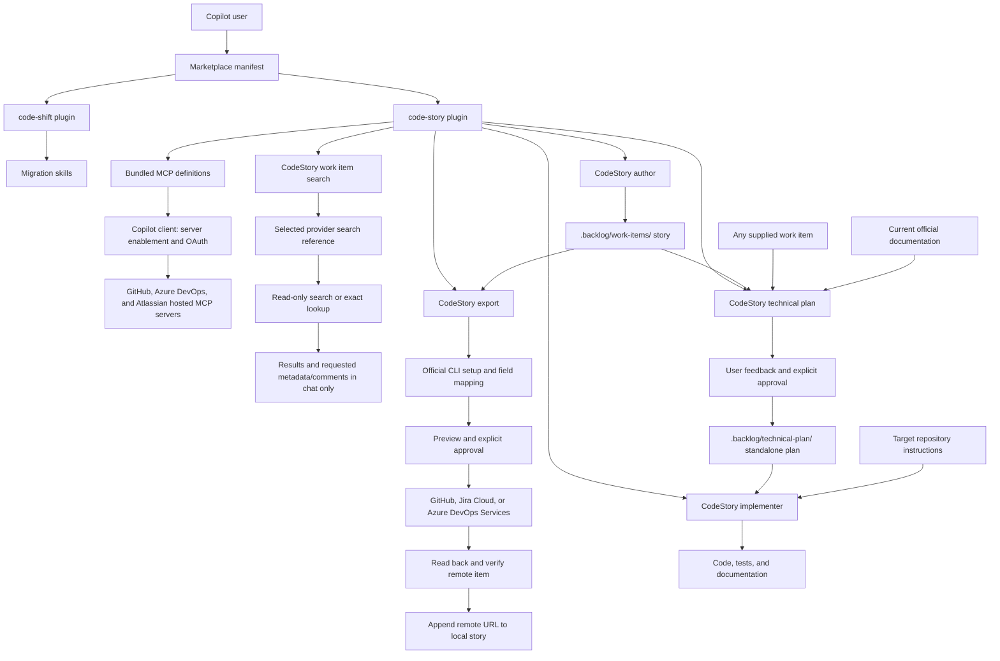

## Architecture

This repository is a GitHub Copilot agent-plugin marketplace. The marketplace manifest discovers independently installable plugins under `plugins/`; each plugin manifest exposes a directory of self-contained skills. CodeStory also exposes bundled hosted MCP server definitions.

CodeStory's [MCP configuration](plugins/code-story/.mcp.json) contains no credentials or organization-specific settings. The client owns connections and authentication; callers supply confirmed provider scope, including the organization on each Azure DevOps tool call. Users can disable individual bundled servers to retain existing global connections without disabling the skills. These definitions do not change the search and export skills' CLI-first behavior. See [MCP setup](plugins/code-story/README.md#mcp-servers) for requirements and verification.

The independent search skill accepts keywords across title, description, and acceptance criteria, or exact IDs/keys and URLs. Provider references own authentication, field discovery, queries, and bounded pagination for Azure DevOps Services, GitHub issues, and Jira Cloud. Results remain in chat, with comments only on request; search never writes backlog files or modifies remote items. Access failures and partial field/search coverage are explicit.

The optional exporter guides CLI installation and authentication, resolves destination fields with the user, and creates an item only after preview approval. It appends the verified browser URL to the local story without changing its existing content. Partial failures are reported explicitly and recover the existing remote item rather than creating a duplicate.

The planner accepts work items from any source without requiring the author skill. It develops a high-level architectural approach with the user, including justified code or folder restructuring, and writes the standalone plan only after explicit approval. The source work item remains unchanged.

The implementer consumes the approved high-level plan, translates its architecture and delivery sequence into concrete changes, and appends implementation status and closeout to the plan. Legacy stories with embedded plans remain supported. Implementation follows the target repository's instructions, language, frameworks, and tooling without bundled cross-project defaults.

Material design or scope changes return to planning for approval. Required checks and in-scope acceptance outcomes must pass before implementation is recorded as complete; unavailable or failing validation remains explicit in an incomplete or blocked closeout.
