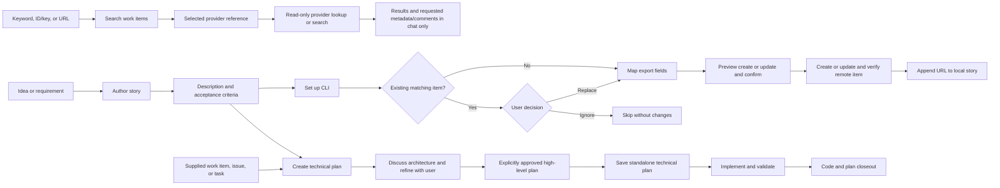

> A GitHub Copilot agent plugin that searches remote work items, authors and exports backlog stories, then turns work items into planned, implemented, and verified code.

CodeStory separates backlog delivery into three stages. Author a story when needed, or start planning with any supplied work item. Story backgrounds live under `.backlog/work-items/`; approved high-level plans live under `.backlog/technical-plan/` and become the record of implementation and closeout.

Export is an optional workflow: publish a local story to GitHub, Jira Cloud, or Azure DevOps Services through its official CLI, approve the preview, and save the verified remote URL back into the story. Remote titles use only the human-readable story title, without the local story ID or filename slug; local headings and filenames stay unchanged.

Search is independent and read-only: find remote work items by keyword in title, description, or acceptance criteria, or retrieve an exact ID/key or URL. Results stay in chat; comments are fetched only when requested, along with any requested accessible metadata. Search does not import items or write local files.

## Workflow



| Stage | Skill | Outcome |
| --- | --- | --- |
| Search (independent) | `code-story-work-item-search` | Searches Azure DevOps Services, GitHub issues, or Jira Cloud and shows results only in chat, with optional comments and requested metadata. |
| Author | `code-story-author` | Creates the Description and Acceptance Criteria after clarifying business intent. |
| Export (optional) | `code-story-export` | Guides official CLI installation and sign-in, maps fields interactively, exports only after preview approval, and appends the verified remote URL to the local story. |
| Plan | `code-story-technical-plan` | Accepts any supplied work item, develops an architecture-led plan interactively, verifies version-sensitive facts, and saves `.backlog/technical-plan/<story-title-slug>.md` only after explicit approval. |
| Implement | `code-story-implementer` | Executes the approved high-level plan using the target repository's language, tooling, and conventions, validates acceptance outcomes, and records implementation status and closeout in that plan. Legacy stories with embedded plans remain supported. |

## Installation

```sh
/plugin install code-story@krprashantpk-plugins
```

For an existing installation, run `/plugin update code-story`, then start a new session.

## MCP servers

The [plugin manifest](plugin.json) loads [.mcp.json](.mcp.json), which bundles the official hosted servers below using Streamable HTTP. No Node.js, Docker, environment variables, or credentials in repository files are required for these connections. Authentication is managed by the client through browser sign-in; service access and organization policies still apply.

| Server name | Provider and setup guide | Endpoint | Required access |
| --- | --- | --- | --- |
| `code-story-github` | [GitHub](https://docs.github.com/en/copilot/how-tos/provide-context/use-mcp/set-up-the-github-mcp-server) | `https://api.githubcopilot.com/mcp/` | GitHub sign-in and permission to the selected repository. |
| `code-story-ado` | [Azure DevOps Services](https://learn.microsoft.com/en-us/azure/devops/mcp-server/remote-mcp-server?view=azure-devops) | `https://mcp.dev.azure.com/` | Microsoft Entra sign-in, a tenant-backed organization, and project access. Standalone Microsoft-account organizations are not supported by this remote server. |
| `code-story-jira` | [Atlassian Rovo for Jira Cloud](https://developer.atlassian.com/cloud/rovo-mcp/guides/getting-started/) | `https://mcp.atlassian.com/v2/mcp` | Atlassian OAuth sign-in and access to the selected Jira site and project. The server also exposes other Atlassian apps subject to your permissions. |

The Azure DevOps endpoint intentionally omits an organization so this plugin can be shared unchanged. Supply the confirmed organization as context for every Azure DevOps tool call. Confirm the GitHub repository or Jira site/project before accessing those providers as well.

### Connect and verify

1. Install or update CodeStory and open a fresh session in an MCP-capable Copilot client.
2. In VS Code, open **Chat: Open Customizations > MCP Servers** in that session. In Copilot CLI, run `/mcp`.
3. Find the CodeStory entries, enable only the providers you need, and authenticate when prompted. If authentication or policy blocks access, report the failure and resolve it before retrying; never paste tokens into this plugin's files.
4. Request a read-only lookup of a known work item in a confirmed repository, organization/project, or Jira site. Verify the returned identifier and source. Listing a server alone does not verify authentication or access.

Bundled servers can expose write tools; their availability is not approval to use them. Search and planning remain read-only, and export retains its preview and explicit approval requirements. Bundling MCP does not change the search and export skills' existing CLI-first behavior; MCP tools are available to workflows that permit them.

### Reuse an existing global connection

There is no portable conditional setting to skip a bundled server when an equivalent global connection exists. The `code-story-` names distinguish these definitions from user-managed ones, but do not deduplicate them. Copilot CLI also has a built-in GitHub MCP server.

To keep an existing connection, disable only the corresponding plugin-provided server in the intended session's **MCP Servers** controls, leaving CodeStory itself enabled. In Copilot CLI, use `/mcp list` to find the runtime server name, then `/mcp disable <server-name>`; `/mcp enable <server-name>` reverses it. Runtime names can include a plugin namespace. Do not copy bundled definitions into global configuration or edit the installed plugin cache.

See [plugin MCP behavior](https://code.visualstudio.com/docs/agents/reference/agent-plugin-reference#_mcp-servers-in-plugins) and [server enablement controls](https://code.visualstudio.com/docs/agents/run/manage-mcp-servers#_control-or-remove-a-server) for client-specific controls and scopes.

## Usage

Describe the stage you want to run in natural language. The matching skill activates automatically.

- *"Create a backlog story for exporting invoices."*
- *"Search ADO work items for invoice in title, description, or acceptance criteria."*
- *"Find GitHub issue 42 in owner/repo and show its labels and milestone."*
- *"Show Jira TEAM-123, including comments, story points, and due date."*
- *"Export STORY-12 to Jira."*
- *"Publish .backlog/work-items/STORY-12-export-invoices.md as a GitHub issue."*
- *"Create a high-level technical plan for STORY-12."*
- *"Plan the implementation of this issue: <issue URL or pasted work item>."*
- *"Implement the approved plan at .backlog/technical-plan/export-invoices.md."*

Planning does not require a story created by the author skill. The planner first reviews available architecture, project-structure, and README documentation, along with relevant previous technical plans and their history. When needed, it researches current official guidance on patterns, services, and technologies.

The [search skill](skills/code-story-work-item-search/SKILL.md) keeps the shared workflow provider-agnostic and loads the selected [provider reference](skills/code-story-work-item-search/SKILL.md#provider-references) for source context, authentication, queries, custom fields, and pagination. It reuses authenticated CLI sessions (`az`, `gh`, or `acli`); Jira capabilities absent from ACLI may require an authenticated read-only connector. It asks for missing source context rather than guessing, includes closed items by default, returns concise 20-item batches, and reports unavailable fields and incomplete coverage. Excerpts and extra metadata appear only when requested or needed to disambiguate; comments require an explicit request. Acceptance-criteria custom fields are discovered rather than hard-coded. No provider work items or repository files are changed.

The exporter keeps its shared workflow provider-agnostic and loads only the selected [provider reference](skills/code-story-export/SKILL.md#provider-references). Each provider has one Markdown file covering supported deployments, destination details, CLI setup, duplicate search, field mapping, creation, updates, and verification. It uses `gh` for GitHub, Atlassian `acli` for Jira Cloud, or `az` with the `azure-devops` extension for Azure DevOps Services. It helps install only the selected CLI from official sources and guides browser sign-in without collecting credentials. Immediately after setup, it checks for matching work items; if any exist, you choose to skip the export without changes or replace a selected item's content from the local story while retaining its ID and URL. Creation or replacement requires a complete preview and explicit approval. Jira Data Center, Atlassian Government Cloud, and Azure DevOps Server are not supported by this workflow.

The planner discusses component responsibilities, interactions, trade-offs, delivery sequence, and validation with you, including justified changes to existing code or folder structure. Feedback is incorporated before approval; the supplied work item stays unchanged.

The implementer turns the approved architecture and delivery sequence into concrete code, tests, configuration, and documentation changes without requiring a file-by-file checklist. Material design or scope changes return to planning for approval. Failed or unavailable required validation leaves implementation incomplete or blocked; the plan records the actual results and follow-ups.

## Project structure

```text
code-story/
├── plugin.json                                  # Plugin manifest, skills, and MCP configuration path
├── .mcp.json                                    # Hosted GitHub, Azure DevOps, and Atlassian servers
├── README.md                                    # Plugin overview, installation, and usage
└── skills/
    ├── code-story-work-item-search/
    │   ├── SKILL.md                             # Provider-agnostic, chat-only remote search
    │   └── references/                          # Search, metadata, and optional comments by provider
    │       ├── github.md
    │       ├── jira-cloud.md
    │       └── azure-devops.md
    ├── code-story-author/
    │   └── SKILL.md                             # Authors story background and acceptance criteria
    ├── code-story-export/
    │   ├── SKILL.md                             # Shared export workflow and URL write-back
    │   └── references/                          # One Markdown guide per supported provider
    │       ├── github.md
    │       ├── jira-cloud.md
    │       └── azure-devops.md
    ├── code-story-technical-plan/
    │   └── SKILL.md                             # Saves the approved high-level technical plan
    └── code-story-implementer/
        └── SKILL.md                             # Implements, validates, and records plan closeout
```

## Development verification

There is no automated test suite for this plugin. After installation or update, check that Copilot CLI discovers its bundled MCP definitions:

```sh
copilot mcp list --json
```

For local development, run `copilot plugin install .` from this plugin's directory first, preferably with `COPILOT_HOME` pointing to a separate test directory. Reinstall after edits because direct installations are cached. A temporary `--plugin-dir` mount is not included in `mcp list` by every CLI version.

Confirm that all three CodeStory servers are listed with a plugin source. This checks configuration discovery, not a live authenticated connection; use the read-only lookup above to verify access.

## License

[MIT](../../LICENSE)
